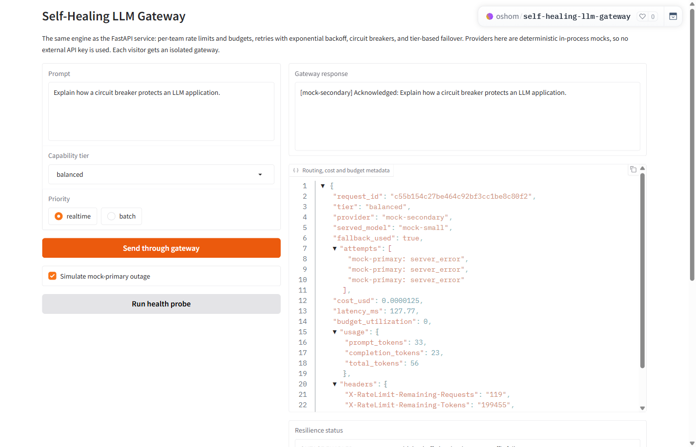

# Self-Healing LLM Gateway

[](https://github.com/osho-m/self-healing-llm-gateway/actions/workflows/ci.yml)

[](LICENSE)
[](https://huggingface.co/spaces/oshom/self-healing-llm-gateway)

A gateway that sits between your apps and your language models. Every request passes through it. It keeps each team within its rate limit and daily budget, and when a model fails it retries and switches to another model, so your app keeps answering.

**[Try the live demo](https://huggingface.co/spaces/oshom/self-healing-llm-gateway)** · [Providers](docs/providers.md) · [Benchmarks](docs/benchmarks.md) · [Real-model run](docs/real-model-run.md) · [Build plan](docs/PLAN.md) · [Security](SECURITY.md)


## The problem it solves

When several teams share language models, three things go wrong:

- one busy team uses up capacity that another team needs;
- a runaway job spends the month's budget in an afternoon;
- one model goes down and takes the product with it.

The gateway handles all three in one place. An app asks for a tier (`economy`, `balanced` or `premium`) instead of a specific model, and the gateway picks which model answers.

## What it does

**Limits per team.** Each team has a cap on requests per minute and tokens per minute. The check runs as one atomic step in Redis, so two replicas can never both let the same request through. Batch jobs cannot use the share kept for live users. A team over its limit gets HTTP `429` with a `Retry-After` header.

**Budgets in dollars.** Before a call, the gateway reserves the most it could cost. After the call, it charges the real cost and releases the rest. Parallel and streaming requests therefore cannot overspend. Teams get a warning at 80% and are blocked at 100%.

**Healing when a model fails.** Temporary errors (rate limits, server errors, timeouts, dropped connections) are retried with a short, growing delay. If one model keeps failing, its circuit breaker opens and traffic goes to the next model in the tier. After a cooldown, one test request checks whether the model has recovered. Permanent errors, such as a bad request, are returned right away and never retried.

**Streaming.** Answers can stream token by token. If a model fails before sending anything, the gateway switches models without the client noticing.

**Any model.** It works with open-source models served by Ollama or vLLM, with models running inside the gateway process (such as a Transformers model on a GPU), and with hosted APIs such as Anthropic and OpenAI. Adding a model is a config change. A model whose API key is missing is skipped and reported, not called.

**Easy to run.** The policy is one YAML file that reloads when it changes. Admins can change a team's limits at runtime, and every change goes into an audit log. In production mode the gateway refuses to start with an unsafe setup.

**Easy to watch.** Prometheus metrics, OpenTelemetry traces, JSON logs, three Grafana dashboards, and alerts sent to Slack.

## Results

All numbers are measured. [docs/benchmarks.md](docs/benchmarks.md) explains how.

| What | Result |
| --- | --- |
| Time the gateway adds, at 100 requests per second with Redis | p99 of 2.5 to 4.7 ms across two CI runs (target: under 10 ms) |
| Throughput on a shared 4-vCPU CI machine | up to 630 requests per second, with zero errors |
| Performance fix | 83 to 463 requests per second on the same 2-vCPU machine, after finding and replacing a slow HTTP client |
| Real outage (local Ollama process killed) | Connection errors opened the circuit and the fallback answered. The circuit closed again once Ollama was back ([details](docs/real-model-run.md)) |
| Live demo with a real model | Qwen2.5-1.5B-Instruct on a free Hugging Face GPU answered through the gateway in about 0.8 s (2.9 s on the first request). During a simulated outage another model answered instead |
| Tests | 103 tests on Python 3.11 to 3.13 against a real Redis, with ruff and mypy clean |

## How a request flows

```text
client --> auth --> enrichment --> admission --> router --> settle + telemetry
           (team    (system         (one atomic    |
            key)     prompt,         Redis step:   +-- retry with backoff (temporary errors only)
                     blocklist)      rate limit    +-- circuit breaker per model
                                     + budget)     +-- fallback to the next model in the tier
                                                         |
                                  Ollama / vLLM / in-process model / hosted API / mock

/metrics --> Prometheus --> Grafana (Operations, Business, Performance)
                       \--> Alertmanager --> Slack          OTLP traces --> Jaeger
```

| Part | Where |
| --- | --- |
| Request pipeline, routing, streaming | `app/gateway.py` |
| Model adapters and error handling | `app/providers/` |
| Rate limits, budgets, runtime overrides (Redis and in-memory) | `app/stores.py` |
| Circuit breaker, health tracking, fault injection | `app/resilience.py` |
| Policy file, validation, hot reload | `app/policy.py` |
| HTTP API and admin endpoints | `app/api.py` |

## Quick start

### Everything in Docker

```bash
cp .env.example .env
docker compose up --build
```

| Service | URL |
| --- | --- |
| Gateway and API docs | http://localhost:8000/docs |
| Grafana | http://localhost:3000 |
| Prometheus | http://localhost:9090 |
| Jaeger | http://localhost:16686 |

A guided script then shows failover, circuit recovery, rate limits, budgets and audited admin changes:

```bash
./scripts/demo.sh        # Windows: .\scripts\demo.ps1
```

### On your machine, with three open-source models

Install [Ollama](https://ollama.com), pull the models, and start the gateway:

```bash
ollama pull smollm2:1.7b && ollama pull qwen2.5:1.5b && ollama pull phi3.5:3.8b
python -m venv .venv && . .venv/bin/activate        # Windows: .venv\Scripts\Activate.ps1
pip install -e '.[dev]'
GATEWAY_POLICY_PATH=config/policy.ollama.yml GATEWAY_ADMIN_API_KEY=local-admin-key-0123456789 \
  uvicorn app.main:app_factory --factory --reload
```

Without `GATEWAY_REDIS_URL` the gateway keeps its counters in memory. That is fine for one copy in development; production mode requires Redis.

### Send a request

```bash
curl -X POST http://localhost:8000/v1/chat/completions \
  -H 'Content-Type: application/json' -H 'X-API-Key: demo-live-key' \
  -d '{"model":"balanced","messages":[{"role":"user","content":"Explain circuit breakers."}]}'
```

The response has the same shape as an OpenAI chat completion, plus an `x_gateway` block. It tells you which model answered, whether a fallback was used, every attempt, the cost, the latency and how much of the budget is used.

## API

| Endpoint | Auth | Purpose |
| --- | --- | --- |
| `POST /v1/chat/completions` | team | Chat completion; streams when `stream: true` |
| `GET /v1/models` | team | The team's tiers and their fallback order |
| `GET /healthz`, `GET /readyz` | none | Liveness and readiness |
| `GET /metrics` | none | Prometheus metrics (restrict at the network layer) |
| `GET /v1/admin/providers` | admin | Model health, circuit state, error rate, latency, history |
| `POST /v1/admin/providers/{name}/simulate-outage` | admin | Turn a fake outage on or off |
| `GET /v1/admin/teams/{id}/status` | admin | Limits, what is left, spend and budget use |
| `PATCH /v1/admin/teams/{id}` | admin | Change limits, budget or tiers at runtime (audited) |
| `GET /v1/admin/audit` | admin | Recent admin actions |

Errors use the OpenAI shape `{"error": {"type", "code", "message"}}`:

| Status | Code | Meaning |
| --- | --- | --- |
| `400` | `content_policy_violation` | Blocked by the team's rules or by the model |
| `401`, `403` | `invalid_api_key`, `tier_not_allowed` | Wrong key, or the team may not use this tier |
| `429` | `rate_limit_exceeded`, `budget_exceeded` | Limit or daily budget reached (`Retry-After` is set) |
| `502` | `upstream_error` | The model rejected the request |
| `503` | `all_providers_unavailable` | Every model in the tier is down |

## Configuration

One policy file lists the models, the fallback order for each tier, the teams and the retry settings. It is checked when loaded and reloaded when it changes. If a new version is invalid, the gateway keeps the last good one. Changes made through `PATCH /v1/admin/teams/{id}` win over the file and are shared through Redis.

```yaml
providers:
  - { name: smollm2, kind: ollama, model: "smollm2:1.7b", base_url: "http://localhost:11434/v1" }
  - { name: qwen,    kind: ollama, model: "qwen2.5:1.5b", base_url: "http://localhost:11434/v1" }
  - { name: phi,     kind: ollama, model: "phi3.5:3.8b",  base_url: "http://localhost:11434/v1" }
tiers:
  economy:  [smollm2, qwen, phi]
  balanced: [qwen, phi, smollm2]
  premium:  [phi, qwen, smollm2]
```

Hosted APIs are added the same way, with `api_key_env` naming the environment variable that holds the key and per-token prices for budget tracking. See [docs/providers.md](docs/providers.md).

Store team keys only as SHA-256 hashes (`python scripts/hash_key.py`). Production mode will not start if Redis is missing, if the admin key is short or a known placeholder, or if the policy contains a plain-text key. See [SECURITY.md](SECURITY.md).

## Monitoring

The gateway reports requests, errors, retries and fallbacks; latency split into total time, model time, gateway time and Redis time; tokens and cost; circuit state and model health; rate-limit rejections; and budget use per team.

Three Grafana dashboards (Operations, Business, Performance) load from `deploy/grafana/dashboards`. Alert rules in `deploy/prometheus/alerts.yml` fire on a high model error rate, an open circuit, a tier with no healthy model, budget thresholds, the latency target, and gateway overhead.

## Tests and CI

```bash
pip install -e '.[dev]'
ruff check . && ruff format --check . && mypy
pytest -q --cov=app            # set REDIS_URL to include the Redis tests
```

Every pull request runs lint and type checks, the tests on Python 3.11 to 3.13 against a real Redis (Redis tests fail instead of skipping when Redis is missing), a check of the Prometheus and Alertmanager configs, a Docker test that boots the whole stack and causes real HTTP failures, and two load tests that fail the build if gateway overhead gets worse.

## Live demo on Hugging Face

The [live demo](https://huggingface.co/spaces/oshom/self-healing-llm-gateway) runs the same gateway code with three open-source models on a free Hugging Face GPU (ZeroGPU). No paid API is used. The setup is in `config/policy.space.yml`.

| Tier | Starts with | Then tries |
| --- | --- | --- |
| economy | SmolLM2-1.7B-Instruct (Apache-2.0) | Qwen, Phi |
| balanced | Qwen2.5-1.5B-Instruct (Apache-2.0) | Phi, SmolLM2 |
| premium | Phi-3.5-mini-instruct (MIT) | Qwen, SmolLM2 |

A simple built-in fallback answers last, so the demo still responds when your free GPU time runs out.

To see the healing, send a request, tick the model your tier starts with under "Simulate an outage of", and send again. The metadata shows the failed attempts and the model that answered instead. Your outage switches affect only you; rate limits are shared by everyone.

| A model answers | Simulated outage: retries, then another model answers |
| --- | --- |
|  |  |

`scripts/sync_space.sh` publishes `main` to the Space.

## Roadmap

1. A long-term usage ledger for invoicing (Postgres or ClickHouse). Redis keeps 48 hours.
2. Circuit state shared across replicas through Redis.
3. Single sign-on for admins instead of a shared admin key, and audit logs shipped to storage that cannot be edited.
4. Idempotency keys, and one deadline per request across all its retries.
5. A target for time to first token when streaming.
6. Real tokenizers for the admission estimate, instead of assuming about 4 characters per token.

## License

[MIT](LICENSE)
