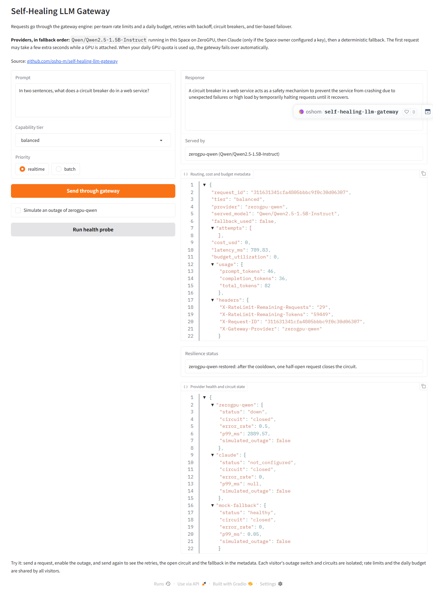

# Self-Healing LLM Gateway

[](https://github.com/osho-m/self-healing-llm-gateway/actions/workflows/ci.yml)

[](LICENSE)
[](https://huggingface.co/spaces/oshom/self-healing-llm-gateway)

An OpenAI-compatible gateway that sits in front of every LLM call in an organization. It enforces per-team rate limits and dollar budgets, and keeps serving traffic when a model provider fails.

**[Live demo](https://huggingface.co/spaces/oshom/self-healing-llm-gateway)** · [Providers](docs/providers.md) · [Benchmarks](docs/benchmarks.md) · [Real-model run](docs/real-model-run.md) · [Build plan](docs/PLAN.md) · [Security](SECURITY.md)



## Why

Teams that call several LLM providers run into the same problems:

- one team's traffic starves another's;
- a runaway job burns the monthly budget;
- a single provider outage takes the product down.

This gateway handles all three in one place. Clients send a standard chat-completions request for a capability tier (`economy`, `balanced`, `premium`), and the gateway decides which provider serves it.

## Features

- **Per-team limits.** Requests per minute and tokens per minute, enforced with atomic Redis token buckets. Batch traffic cannot consume the headroom reserved for realtime traffic. Limited requests get `429` with `Retry-After`.
- **Dollar budgets.** The worst-case cost is reserved before each call and settled at the actual cost afterwards, so concurrent and streaming requests cannot overshoot the cap. Warns at 80% and blocks at 100%.
- **Self-healing routing:**
  - Retryable errors (429, 5xx, timeouts, connection failures) are retried with jittered exponential backoff.
  - A per-provider circuit breaker opens after repeated failures, then admits a single half-open probe after a cooldown.
  - Traffic moves along a per-tier fallback chain.
  - Non-retryable errors are returned immediately and never fail over.
- **Streaming.** SSE passthrough. Failover happens before the first byte, so clients never see a switch. Usage and cost are recorded from the assembled stream.
- **Providers.** OpenAI-compatible APIs, the Anthropic Messages API through the official SDK, Ollama, and in-process models such as a Transformers model on a GPU. Adding a provider is a policy change, not a code change. A provider whose API key is not set is skipped, and the skip is reported, so optional paid tiers turn on when the key is supplied.
- **Operations:**
  - YAML policy with hot reload, plus runtime overrides through an admin API.
  - Every admin change is written to an append-only audit log.
  - Production mode refuses unsafe configuration.
- **Observability.** Prometheus metrics, OpenTelemetry traces, structured JSON logs, three provisioned Grafana dashboards, and alert rules routed to Slack.

## Results

Measured, not estimated. Details and methodology are in [docs/benchmarks.md](docs/benchmarks.md).

| What | Result |
| --- | --- |
| Gateway overhead at 100 req/s, with Redis in the request path | p99 **2.5–4.7 ms** across two CI runs (target: under 10 ms) |
| Capacity on a shared 4-vCPU CI runner | up to **630 req/s**, zero errors |
| Throughput optimization | **83 → 463 req/s** on the same 2-vCPU runner, after finding and replacing an HTTP-client bottleneck |
| Real provider outage (local Ollama process killed) | Connection errors opened the circuit and the fallback served the request; the circuit closed again after the provider returned ([details](docs/real-model-run.md)) |
| Live demo with a real model | Qwen2.5-1.5B-Instruct on ZeroGPU served through the gateway (about 0.8 s warm, 2.9 s cold). Under a simulated outage the request failed over and was still answered; after the cooldown the model served again |
| Test suite | 87 tests on Python 3.11–3.13 against real Redis, with ruff and mypy clean |

## Architecture

```text
client --> auth --> enrichment --> admission --> router --> settle + telemetry
           (team    (system         (one atomic    |
            key)     prompt,         Redis Lua:    +-- retry with backoff (retryable errors only)
                     blocklist)      rate limit    +-- circuit breaker per provider
                                     + budget)     +-- tier fallback chain
                                                         |
                                  OpenAI-compatible / Anthropic / Ollama / mock

/metrics --> Prometheus --> Grafana (Operations, Business, Performance)
                       \--> Alertmanager --> Slack          OTLP traces --> Jaeger
```

| Component | Location |
| --- | --- |
| Request pipeline, routing, streaming | `app/gateway.py` |
| Provider adapters and error classification | `app/providers/` |
| Rate limits, budgets, runtime overrides (Redis Lua and in-memory) | `app/stores.py` |
| Circuit breaker, health tracking, fault injection | `app/resilience.py` |
| Policy model, validation, hot reload | `app/policy.py` |
| HTTP API and admin endpoints | `app/api.py` |

## Quick start

### Full stack with Docker

```bash
cp .env.example .env
docker compose up --build
```

| Service | URL |
| --- | --- |
| Gateway and OpenAPI docs | http://localhost:8000/docs |
| Grafana | http://localhost:3000 |
| Prometheus | http://localhost:9090 |
| Jaeger | http://localhost:16686 |

The guided demo walks through failover, circuit recovery, rate limiting, budgets and audited admin changes:

```bash
./scripts/demo.sh        # Windows: .\scripts\demo.ps1
```

### Local without Docker

```bash
python -m venv .venv && . .venv/bin/activate        # Windows: .venv\Scripts\Activate.ps1
pip install -e '.[dev]'
GATEWAY_ADMIN_API_KEY=local-admin-key-0123456789 uvicorn app.main:app_factory --factory --reload
```

Without `GATEWAY_REDIS_URL`, the gateway uses in-process stores. That is fine for one replica in development; production mode requires Redis.

### Send a request

```bash
curl -X POST http://localhost:8000/v1/chat/completions \
  -H 'Content-Type: application/json' -H 'X-API-Key: demo-live-key' \
  -d '{"model":"balanced","messages":[{"role":"user","content":"Explain circuit breakers."}]}'
```

Responses are OpenAI-shaped, with an extra `x_gateway` block. It reports the serving provider, served model, whether fallback was used, every attempt, cost, latency, and budget utilization.

## API

| Endpoint | Auth | Purpose |
| --- | --- | --- |
| `POST /v1/chat/completions` | team | Chat completion; SSE when `stream: true` |
| `GET /v1/models` | team | Tiers available to the team and their fallback chains |
| `GET /healthz`, `GET /readyz` | none | Liveness and readiness |
| `GET /metrics` | none | Prometheus metrics (restrict at the network layer) |
| `GET /v1/admin/providers` | admin | Provider health, circuit state, error rate, latency, history |
| `POST /v1/admin/providers/{name}/simulate-outage` | admin | Fault injection |
| `GET /v1/admin/teams/{id}/status` | admin | Limits, remaining buckets, spend and utilization |
| `PATCH /v1/admin/teams/{id}` | admin | Change limits, budget or tiers at runtime (audited) |
| `GET /v1/admin/audit` | admin | Recent admin actions |

Errors follow the OpenAI shape `{"error": {"type", "code", "message"}}`:

| Status | Code | Meaning |
| --- | --- | --- |
| `400` | `content_policy_violation` | Blocked by team policy or by the provider |
| `401`, `403` | `invalid_api_key`, `tier_not_allowed` | Authentication or authorization failed |
| `429` | `rate_limit_exceeded`, `budget_exceeded` | Limit or daily budget reached (`Retry-After` set) |
| `502` | `upstream_error` | Non-retryable provider error |
| `503` | `all_providers_unavailable` | The tier's fallback chain is exhausted |

## Configuration

The policy file defines providers, tier fallback chains, teams and resilience settings. It is validated on load and hot-reloaded when it changes; an invalid file is rejected and the last good policy stays active. Runtime overrides from `PATCH /v1/admin/teams/{id}` take precedence and are shared through Redis.

```yaml
providers:
  - { name: anthropic-opus, kind: anthropic, model: claude-opus-5-5, api_key_env: ANTHROPIC_API_KEY,
      input_price_per_mtok: 4.00, output_price_per_mtok: 20.00 }
  - { name: openai-main, kind: openai, model: <model-id>, api_key_env: OPENAI_API_KEY,
      input_price_per_mtok: <current list price>, output_price_per_mtok: <current list price> }
  - { name: ollama-local, kind: ollama, model: "qwen2.5:0.5b", base_url: "http://localhost:11434/v1" }
tiers:
  premium: [anthropic-opus, openai-main, ollama-local]
```

Prices are deployment configuration. Set them from each provider's current price list, and reconcile tracked spend against provider invoices.

Store team keys only as `api_key_sha256` hashes; generate them with `python scripts/hash_key.py`. Production mode refuses to start in any of these cases:

- Redis is not configured;
- the admin key is short or a documented placeholder;
- the policy contains plaintext keys.

See [SECURITY.md](SECURITY.md).

## Observability

The gateway exposes these metrics:

- requests, errors, retries and fallbacks;
- latency, split into end-to-end time, provider time, gateway overhead, and Redis time;
- tokens and cost;
- circuit state and provider health;
- rate-limit rejections;
- budget utilization per team.

Grafana dashboards (Operations, Business, Performance) are provisioned from `deploy/grafana/dashboards`.

Alert rules in `deploy/prometheus/alerts.yml` cover:

- provider error rate;
- open circuits;
- a tier with no healthy provider;
- budget thresholds;
- the latency SLA;
- gateway overhead.

## Testing and CI

```bash
pip install -e '.[dev]'
ruff check . && ruff format --check . && mypy
pytest -q --cov=app            # set REDIS_URL to include the Redis store tests
```

Every pull request runs these checks:

- **Lint and types:** ruff and mypy.
- **Tests:** Python 3.11–3.13 against a real Redis instance. Redis-backed tests fail rather than skip when Redis is missing.
- **Monitoring config:** Prometheus and Alertmanager configs are validated.
- **Docker smoke test:** boots the full Docker Compose stack, then exercises failover against real HTTP faults from the mock provider.
- **Load tests:** two runs, with overhead p95 gated as a regression guard.

## Hugging Face Space

The [live demo](https://huggingface.co/spaces/oshom/self-healing-llm-gateway) runs the same gateway engine in-process, so no Docker is needed. The policy is in `config/policy.space.yml`.

For the default tier, the gateway tries providers in this order:

1. **Qwen2.5-1.5B-Instruct** (Apache-2.0), running in the Space on ZeroGPU. `demo.py` loads it and registers it as a `kind: local` provider.
2. **Claude** (`claude-opus-5-5`), only when the Space owner sets the `ANTHROPIC_API_KEY` secret. It runs at low effort with no background probes, and the demo team's budget is $1 a day.
3. **A deterministic fallback.** It keeps the demo answering when the real providers are unavailable, for example once a visitor's free ZeroGPU quota is used up.

Each visitor's outage switch and circuit state are isolated. Rate limits and the daily budget are shared by all visitors, so opening a new tab cannot reset them.

| Real model serving | Simulated outage: retries, open circuit, fallback serves |
| --- | --- |
|  |  |

The Space is published from `main` with `scripts/sync_space.sh`, which prepends the Hugging Face metadata header to the README.

## Roadmap

1. A durable usage ledger for invoicing (Postgres or ClickHouse). The Redis ledger keeps 48 hours.
2. Circuit-breaker state shared across replicas through Redis.
3. Admin SSO/OIDC instead of a shared admin key, and audit-log shipping to immutable storage.
4. Idempotency keys, plus per-request deadline budgets across retries.
5. A time-to-first-token SLO for streaming.
6. Provider tokenizers for admission estimates instead of the 4-characters-per-token approximation.

## License

[MIT](LICENSE)
